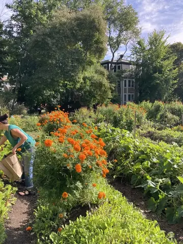

##### Register Here for Year 1

{: style="float: right; width: 50%"}

**Learn to follow the seasons as an herbalist!** In this immersive program we will integrate our bodies with the bodies of the land and learn what bioregional and ancestral plant medicine can look like in New England. **We will follow the whole path of herbal medicine from seed, to harvest, to jar, to body.**

### Quick info:
> - Where: Lexington Community Farm and Midcoast Maine
> - When: Each year will have 4-6 Sunday sessions in Lexington, MA and 2-3 weekend immersions in Midcoast Maine (see below for all the details)
> - Who:
>     - Year One: Herbal enthusiasts wanting to get your hands dirty!
>     - Year Two: Previous herbal students who want to learn to care for their communities more specifically

#### What makes this herb program unique?
- I prioritize community above else. My students who've attended other herb programs previously have shared that they felt closer to their classmates after day one than they did after a whole nine months in other programs.
- Once you're introduced to the farm, it's your farm: you can go anytime to harvest, tend, water, bathe in the lavender, etc. Students are always texting the group chat, "Who wants to go to the farm tomorrow morning?"
- Herbalism can be a tool for collective liberation, and it can also cause so much harm. We reckon with this tension constantly.
- I have a strong chemistry and physiology focus and always want you to understand the "how" behind how herbs work.

### Year One: Bioregional + Ancestral Immersion

#### Daily flow
Each session we’ll start by walking the land, baskets in hand. We’ll take note of the plants that are thriving and those that need extra care. We’ll harvest those that are abundant and at their peak and bring them back to our medicine-making house where we’ll process them and infuse them in oil, vinegar, alcohol, honey, and more.

As we scrub roots and strip leaves we’ll learn all about the medicine of the plants we are working with. Who is this plant, and how can we work with them? What is their chemistry, and what are their traditional uses? How are they best extracted? Who are they best for, and who would do better with other plants?

We will balance hands-on learning with lessons on the foundations of herbalism so that we can build a stronger understanding of the ways plants interact with bodies in general.

#### Things we may learn together
- Starting herbs from seed
- Identification of botanical families
- Proportions of herbal blends
- Propagating herbs from cutting and division
- Herbal energetic systems
- Herbal first aid
- How to process and dry herbs for tea
- Intro to herbal safety
- How to support sleep, digestion, immune system, cardiovascular system, stress and mood, hormonal regulation, and more!

#### Things we may make together
- Wild weed pesto
- Violet syrup
- Oxymels
- Tinctures
- Infused oils
- Salves
- Herbal "coffee"
- Digestive bitters
- Hydrosols
- Flower essences
- Medicinal broths

#### Projects
Each student will be responsible for three projects throughout the session:
1. An herbal tea to share with the class. In the beginning of the program, these will likely be store bought herbs blending based on flavor or vibes. By the end of the program, students will be able to make teas from herbs harvested from the land and blend them based on a specific condition they are trying to address (ie a tea for someone who holds anxiety in their cardiovascular system).
2. An ancestral herbal presentation. We will talk through how to research the plants our ancestors used and each student will have the opportunity to share about the medicine of their ancestors. Don't worry if this intimidates you! You are in good company, and I will hold your hand every step of the way.
4. A final herbal presentation for our medicine show on the last day!

#### Maine Immersions
Think herb camp! During the Maine weekends, we will have the opportunity to spend the whole weekend immersing ourselves in the medicine of the land. There will be free camping available and I will provide recommendations of places to stay for those who prefer. Childcare will be available for all but the last weekend: bring your whole family! While you're learning, they'll be playing with rockweed in the tidepools :) Prepare to leave with an ABUNDANCE of herbs to take home for your communities.

The final weekend will be held at Deer Isle, on a magical tidal cove. We will sauna next to the ocean, harvest clams from the sea (optional!), and add seaweed to all our meals. For this weekend, we'll all camp together (other options available for accessibility), share our meals, and share many of our ancestral presentations. This is one of my favorite places in the world and I can't wait to share it with you.

#### FAQ

**Can I join even if I have no formal herbal training?**
Yes! This program is for herb enthusiasts who are in the beginning of their herbal journey. Maybe you've taken a couple of courses or studied on your own, or maybe you are completely green and ready to dive in.

**What about if I have taken some herb classes and/or played around with herbs a lot? Will I get anything out of this?**
Last year, we had one student who was starting an herb farm, three students who teach herbalism classes, some folks who'd taken at least a dozen of my classes before, and many students who'd never engaged with herbalism before. This program is designed to meet you where you are at and give your learning more structure. If you think you may be ready for Year 2, [book a call to chat with me here](https://zcal.co/i/HNRlGjhc).

**What if I have to miss one of the sessions?**
Most students miss 1-2 sessions, so that's totally fine. Since this is an in-person program we won't be recording the sessions, but I'll send you the handouts and your classmates will share their notes. You can always go to the farm and harvest herbs to make medicine on your own time. That said, if you know you'll need to miss more than 2-3 classes, it may not be the best fit.

**Will there be a lunch break?**
Yes! I recommend you bring a lunch since there aren't a ton of close by options, but there are a few. We'll have at least one potluck as well!

**What if I don't have a car?**
I am committed to offering a car-free accessible program. LexFarm is easily accessible by bus and bicycle, and we will arrange carpools. We will arrange carpools for the Maine immersions which should cover everyone; otherwise, we'll arrange pickups from the bus station.

### The Details:
- LexFarm dates (all Sundays):
    - April 18th 11am-5pm
    - May 16st 11am-5pm
    - October 10th 9am-3pm
    - November 7th 9am-3pm
- Maine dates:
    - June 26th-27th
    - July 31st-August 1st
    - August 28th-29th
- Tiered pricing (Early Bird rates below last till 1/15):
    - Receive a gift: $950
    - Actual cost: $1150
    - Pay it forward: $1350
    - Payment plans available!
- +$100 materials fee for your take home apothecary
- Have questions? [Book a call to chat here](https://zcal.co/i/HNRlGjhc)

### Year Two: Community Herbalism Training

#### Daily flow
Each session will focus on a condition that community herbalists can support with: respiratory infections, menstrual cramps, wound healing, cardiovascular wellness, etc. We'll start by walking the land to ground us in the plants, and harvest those who are looking abundant. We'll meet plants we didn't connect with last year and make new medicinal preparations.

As we process our herbs, we'll learn about the physiology of this condition, and the ways we can work with plants to address it. We will work through case studies and students will work together to come up with protocols for each case.

#### Maine Immersions
Think herb camp! During the Maine weekends, we will have the opportunity to dive deep into topics that would take too long to cover in one session. Think hydrosol making, tongue assessment, getting a full case history, and making an energetic assessment. There will be free camping available and I will provide recommendations of places to stay for those who prefer. Childcare will be available for the first weekend: bring your whole family! While you're learning, they'll be playing with rockweed in the tidepools :) Prepare to leave with an ABUNDANCE of herbs to take home for your communities.

The final weekend will be held at Deer Isle, on a magical tidal cove. We will sauna next to the ocean, harvest clams from the sea (optional!), and add seaweed to all our meals. For this weekend, we'll all camp together (other options available for accessibility), share our meals, and share many of our ancestral presentations. This is one of my favorite places in the world and I can't wait to share it with you.

#### FAQ

**How do I know if I have enough herbal education to take this program?**
Let's talk about it! This program is designed for folks who've completed a similar season-long apprenticeship style herb program to my Year 1 program. If you think you may be ready for Year 2, [book a call to chat with me here](https://zcal.co/i/HNRlGjhc).

**What if I have to miss one of the sessions?**
Most students miss 1-2 sessions, so that's totally fine. Since this is an in-person program we won't be recording the sessions, but I'll send you the handouts and your classmates will share their notes. You can always go to the farm and harvest herbs to make medicine on your own time. That said, if you know you'll need to miss more than 2-3 classes, it may not be the best fit.

**Will there be a lunch break?**
Yes! I recommend you bring a lunch since there aren't a ton of close by options, but there are a few. We'll have at least one potluck as well!

**What if I don't have a car?**
I am committed to offering a car-free accessible program. LexFarm is easily accessible by bus and bicycle, and we will arrange carpools. We will arrange carpools for the Maine immersions which should cover everyone; otherwise, we'll arrange pickups from the bus station.
LexFarm:
3/21
4/25
5/23
9/12
10/24
11/14

Maine:
7/17-18
8/14-15

### The Details:
- LexFarm dates (all Sundays):
    - March 21st 11am-5pm
    - April 25th 11am-5pm
    - May 23rd 11am-5pm
    - September 12th 11am-5pm
    - October 10th 11am-5pm
    - November 7th 10am-4pm
- Maine dates:
    - July 17-18th
    - August 14-15th
- Tiered pricing (Early Bird rates below last till 1/15):
    - Receive a gift: $950
    - Actual cost: $1150
    - Pay it forward: $1350
    - Payment plans available!
- +$100 materials fee for your take home apothecary
- Have questions? [Book a call to chat here](https://zcal.co/i/HNRlGjhc)
