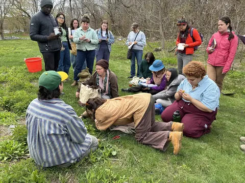
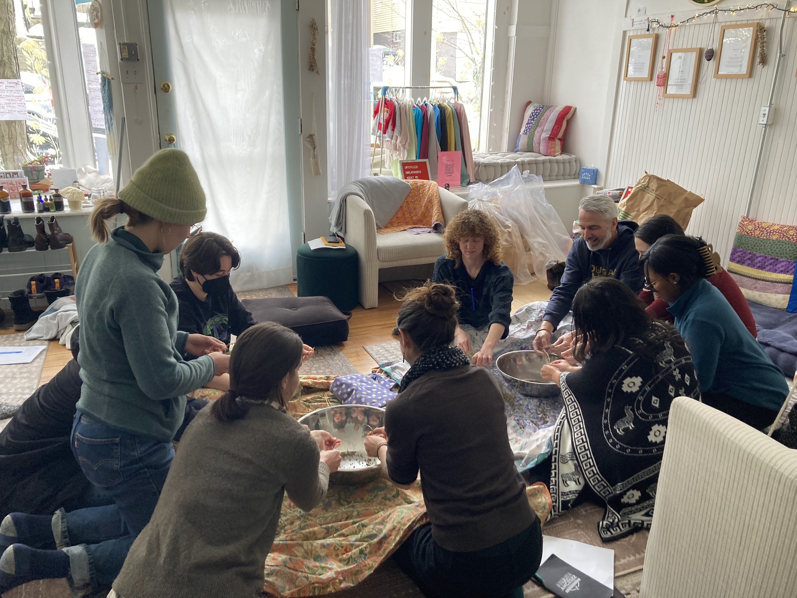
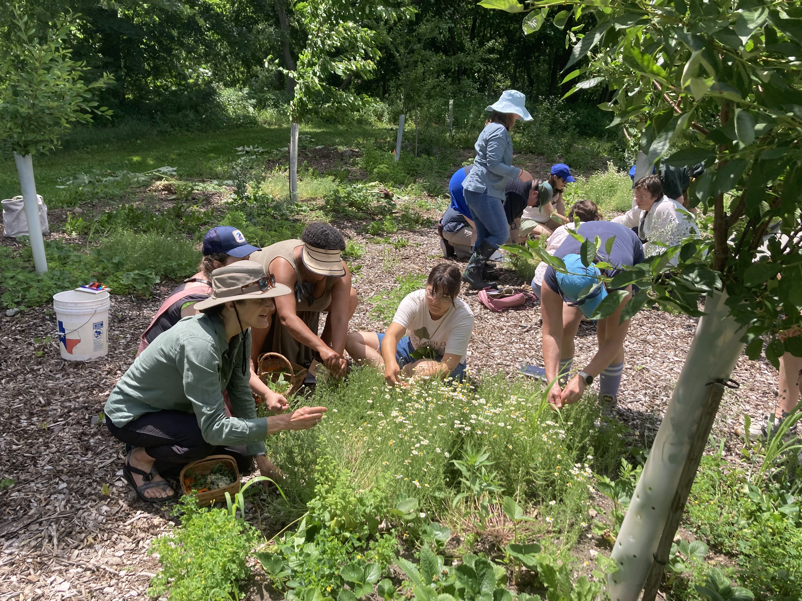

{: style="float: right; width: 50%"}

Want to learn to care for your community using plants? In the longer immersion programs, we dive deep into learning how to use plants for community care.

I offer several longer programs throughout the year including:
- a [Seeds of Herbalism winter intensive](https://mokatzchristy.com/winter_seeds.html) 
- A two-year [Bioregional Community Herbalist training program](https://mokatzchristy.com/bioregional_immersion.html)
- weekend immersion programs

{: style="float: right; width: 45%"}

### [Winter Seeds of Herbalism](https://mokatzchristy.com/winter_seeds.html):

> 7 week winter herbal immersion\
> 4 hours every Sunday, January-March\
> Rockweed, Belfast ME\
> [More info here](https://mokatzchristy.com/winter_seeds.html)

{: style="float: right; width: 45%"}

### [Bioregional Community Herbalist training program](https://mokatzchristy.com/bioregional_immersion.html)

> Two years of herbal learning\
> Sundays in Lexington, MA and weekend immersions in Midcoast Maine\
> Sign up for one or both years\
> [More info here](https://mokatzchristy.com/bioregional_immersion.html)

---

If you'd like to find out what programs are coming up you can...






